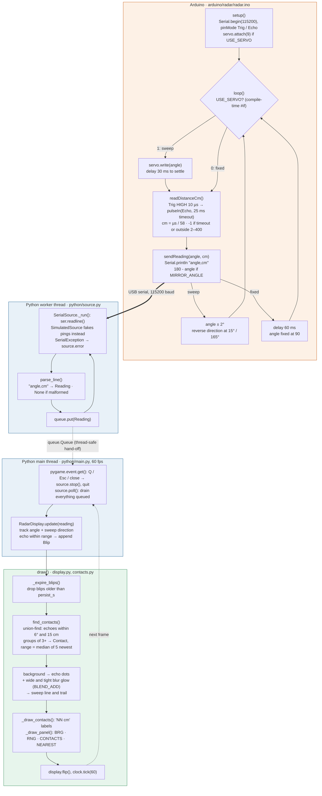

# Architecture

How the code fits together, from the Arduino ping to a pixel on screen. The same diagram is in [`diagrams/code-flow.mmd`](diagrams/code-flow.mmd) for any Mermaid viewer.

## Key points

- **Serial protocol:** one ASCII line per reading, `<angle>,<distance_cm>
` at 115200 baud. `-1` means no echo. This line is the only contract between the Arduino and Python.
- **Threads:** the serial read blocks, so it runs on a daemon worker thread (`_ThreadedSource`). The main thread never touches the port. It only drains the `queue.Queue` once per frame with `poll()`.
- **Sources are interchangeable:** `SerialSource` and `SimulatedSource` share the same `start()` / `poll()` / `stop()` / `error` interface, so `--simulate` exercises everything except the hardware.
- **State lives in `RadarDisplay`:** `update()` only appends a `Blip`. Expiry, grouping into `Contact`s and rendering all happen in `draw()`, so they run once per frame no matter how many readings arrived.
- **Rendering:** echoes are drawn on a black layer and added onto the screen with `BLEND_ADD`, along with two blurred copies for the glow. The background (rings, bearings) is rendered once in `__init__`.

## Where to change things

| To change | Edit |
|---|---|
| Sweep arc, step, speed, mirroring | Constants at the top of `arduino/radar/radar.ino` |
| Fixed vs sweeping sensor | `#define USE_SERVO` in `radar.ino` |
| What counts as one object | `ANGLE_GAP_DEG`, `DISTANCE_GAP_CM`, `MIN_HITS` in `python/contacts.py` |
| Dot size, glow, colours | Constants at the top of `python/display.py` |
| Display range, fade time | `--range`, `--persist` on `python/main.py` |
