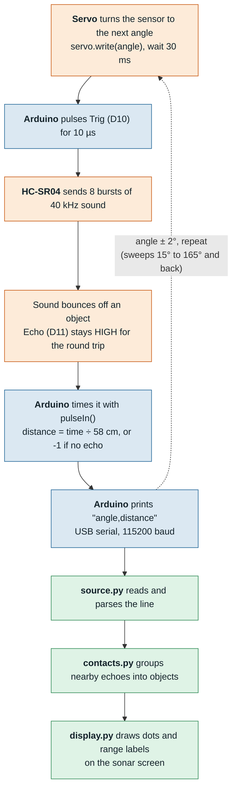
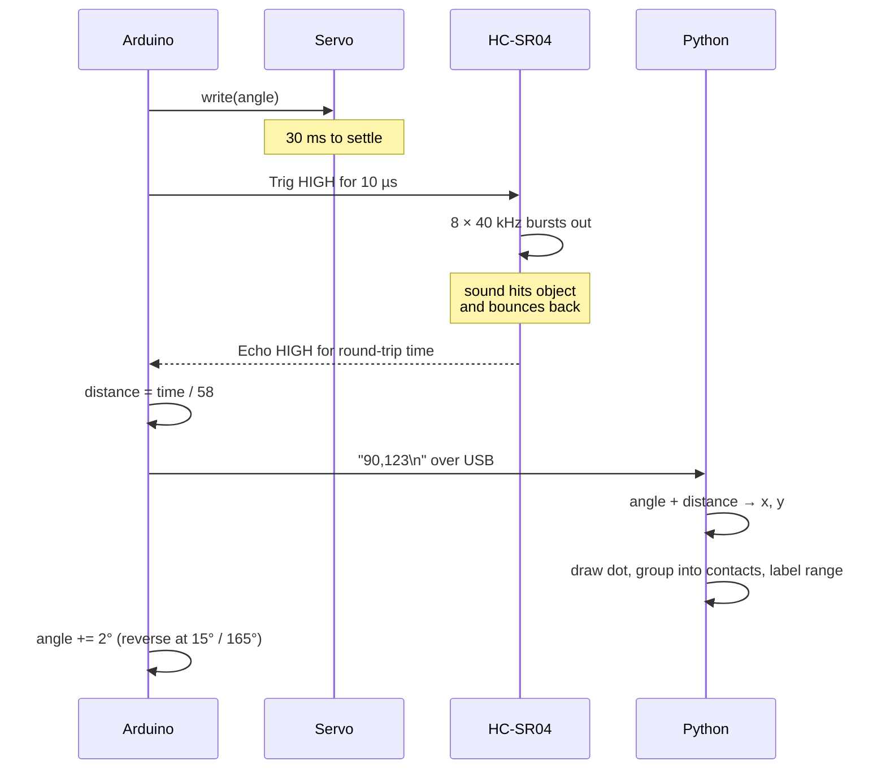

# How it works

Each diagram is also in `docs/diagrams/` as a standalone `.mmd` file, so it opens in any Mermaid viewer or at mermaid.live.

## System overview

Orange steps happen in the hardware, blue on the Arduino, and green on the laptop.

## One ping, step by step

## Why divide by 58?

Sound travels at about 343 m/s, which is 0.0343 cm/µs. It covers 1 cm in about 29.15 µs, and the pulse goes there and back, so each centimetre of distance adds 2 × 29.15 ≈ 58 µs to the echo time.
