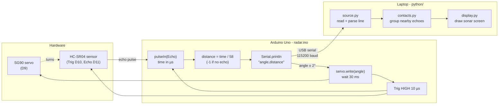
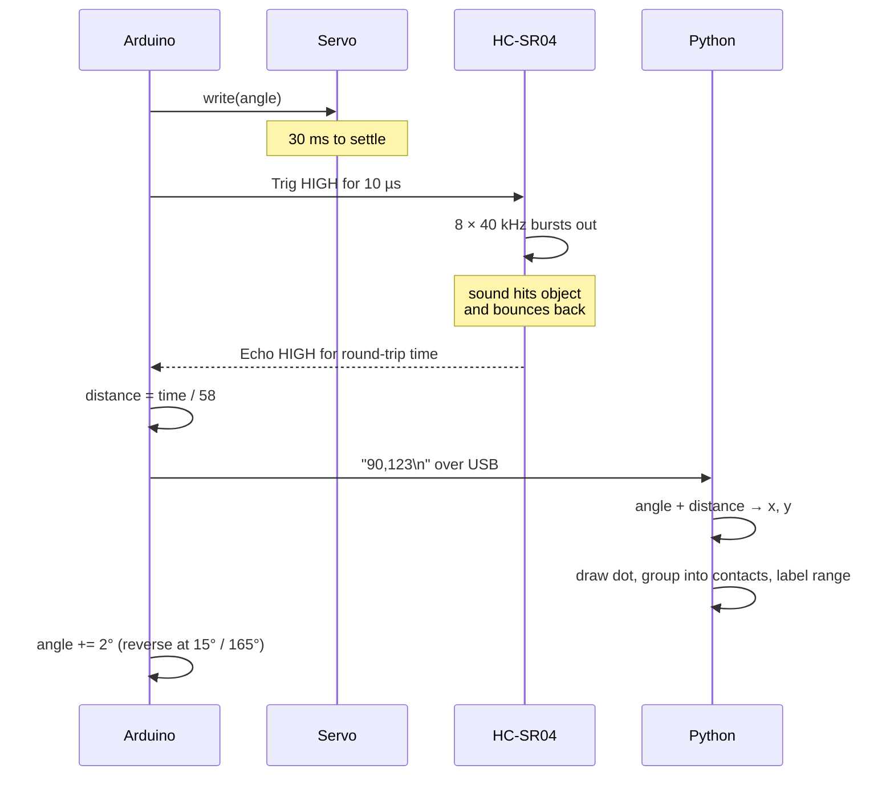

# How it works

## System overview

## One ping, step by step

## Why divide by 58?

Sound travels at about 343 m/s, which is 0.0343 cm/µs. It covers 1 cm in about 29.15 µs, and the pulse goes there and back, so each centimetre of distance adds 2 × 29.15 ≈ 58 µs to the echo time.
